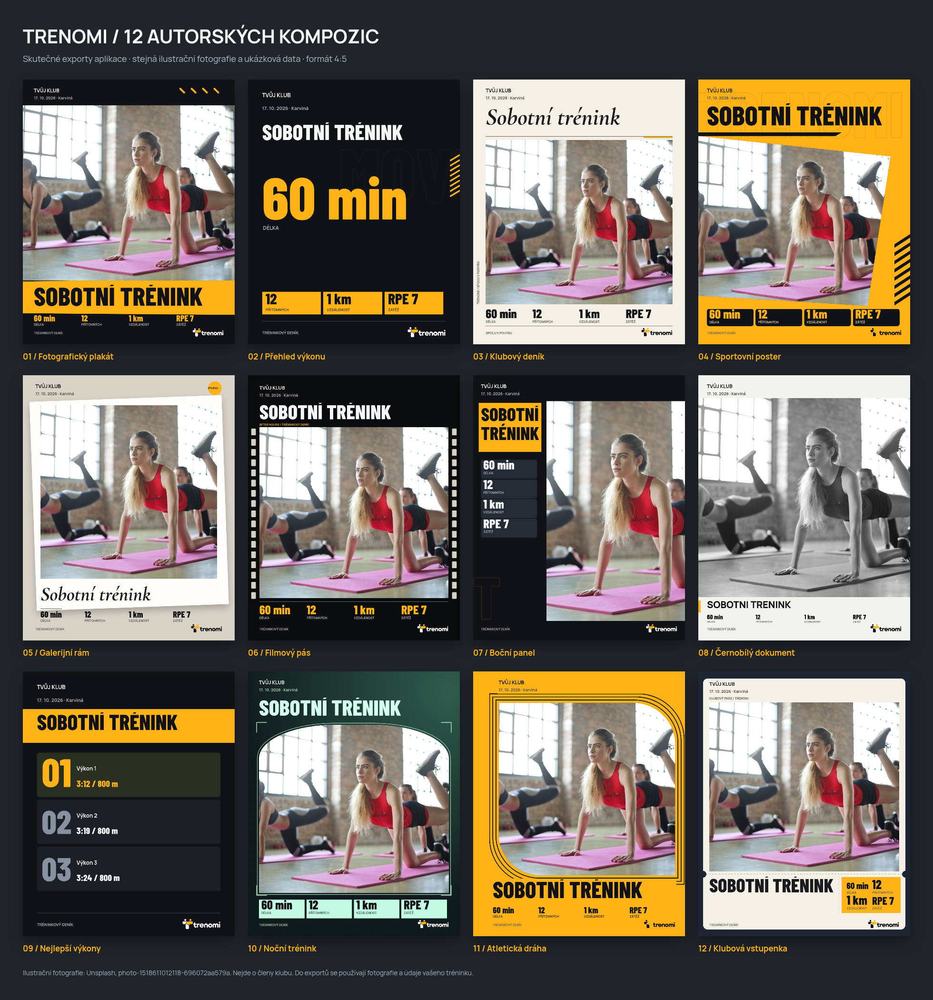
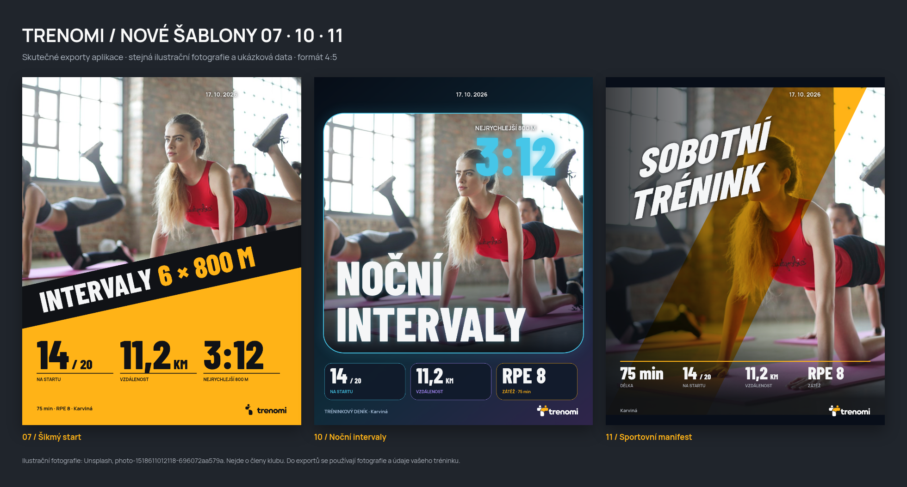

# Grafika pro sdílení tréninku

V trenérském Deníku otevřete záznam tréninku a panel **Sdílet trénink**.

Přehled výše vzniká přímo stejným Canvas rendererem jako stažené PNG. Používá ilustrační fotografii z Unsplash (photo-1518611012118-696072aa579a) a smyšlené údaje, nikoli data členů. Fotografie se do aplikace nepřidává; každý klub používá vlastní galerii.

| Šablona | Vlastní vizuální princip |
| --- | --- |
| 01 Fotografický plakát | Celoplošný snímek, diagonální žlutý titulkový pás a kompaktní údaje mimo fotografii. |
| 02 Přehled výkonu | Výrazná hlavní skutečná hodnota, obrysová typografie a žluté datové bloky. Bez fotografie. |
| 03 Klubový deník | Světlá magazínová sazba s výrazným kurzivním serifovým písmem a boční tiráží. |
| 04 Sportovní poster | Žlutá kampaňová grafika, velký název, diagonální fotografický výřez a černé datové štítky. |
| 05 Galerijní rám | Nakloněná papírová karta se stínem, fotografií a serifovým popiskem. |
| 06 Filmový pás | Filmové perforace po stranách, titulková sazba a tmavá kompozice. |
| 07 Šikmý start | Dominantní fotografie, šikmý černý pás s bílým názvem a barevnou disciplínou, velké černé hodnoty v akcentové spodní části. |
| 08 Černobílý dokument | Velká monochromatická fotografie a drobná čistá sazba. Černobílá úprava platí jen pro export, ne pro originál. |
| 09 Nejlepší výkony | Tři výsledkové karty s velkým pořadím, skutečnými hodnotami a jmény standardně skrytými. Bez fotografie. |
| 10 Noční intervaly | Modrý světelný rám, velký dvouřádkový bílý nadpis uvnitř fotografie, skutečný nejrychlejší úsek a tři samostatné datové karty. |
| 11 Sportovní manifest | Celoplošná fotografie, menší bílá sportovní typografie s výraznějším sklonem i zešikmením, diagonální akcentový pás a kompaktní údaje u spodního okraje. |
| 12 Klubová vstupenka | Krémová perforovaná vstupenka, fotografie a samostatný žlutý datový útržek. Nejde o vstupní oprávnění ani QR kód. |
| 13 Kilometry | Velká hodnota vzdálenosti a název nad fotografií. |
| 14 Sloupec dat | Svisle uspořádané skutečné metriky vedle dominantní fotografie. |
| 15 Jen titulek | Fotografie s výrazným názvem a kompaktním souhrnem. |

Volbu otevřete kliknutím na aktuální šablonu (**Vybrat vzhled · 15**). Nabídka obsahuje číslované miniatury a po volbě se zavře. Náhledy nabídky se vykreslují jen při jejím otevření.

Sedm původních fotografických šablon drží typografii mimo snímek. Nové návrhy **07, 10 a 11** podle předloh záměrně kombinují fotografii s velkými nadpisy či šikmým pásem. Výřez lze upravit tak, aby hlavní osoby zůstaly viditelné. Noční rám a diagonální výřez mají odpovídající tvar dotykové plochy. Volba Celá fotografie zachová celý obdélníkový snímek.
Náhledové kartičky používají aktuální údaje. Logo a název klubu se vkládají volitelně jako posuvný prvek, datum používá časové pásmo Europe/Prague. Chybějící délka, vzdálenost, RPE ani nejrychlejší úsek se nevymýšlí. Nejrychlejší úsek v 07/10 se přebírá ze skutečně změřeného nejrychlejšího úseku vybrané délky v deníku, nikoli z průměru žebříčku. Lze ho skrýt i obnovit jako ostatní údaje.

Šablona 10 má výchozí modrý akcent, 07 a 11 původní oranžovou #FFB317. Ručně vybraná barva ze 16 odstínů se při změně šablony zachovává. Pozadí a barevné proměnné aplikace se nemění.

## Fotografie a výřez

Fotografii vyberte v galerii tréninku. Ve všech fotografických šablonách lze volit:

- **Vyplnit rámeček** (výchozí): fotografie zaplní vyhrazenou plochu, přesah se ořízne.
- **Celá fotografie**: při základním přiblížení zůstane vidět celý snímek; rozdíl poměrů stran vyplní neutrální pozadí. Vhodné pro skupiny, kde nechcete nikoho oříznout.

Na notebooku a počítači zůstávají posuvníky **Přiblížení**, **Vodorovný posun** a **Svislý posun**.

Na mobilním zařízení posouvejte fotografii přímo prstem v náhledu; dvěma prsty ji přibližujte/oddalujte v rozsahu 1–3×. Přiblížení drží uchopené místo pod prsty a lze současně posouvat. Dotyková plocha odpovídá fotografii včetně tvarovaných rámečků; rolování stránky funguje mimo snímek. Pro přístupnost zůstávají posuvníky dostupné pod **Přesné nastavení výřezu**. Dotykový režim se určuje podle vstupu zařízení (coarse pointer bez hover), nikoli pouze podle šířky okna. Na notebooku s myší tak zůstane původní ovládání i v úzkém okně.

**Obnovit výřez** vrátí střed a základní přiblížení při zachování způsobu zobrazení. Při vyplnění může být v základním přiblížení jeden posuv bez účinku, pokud fotografie daný rozměr přesně vyplňuje. Výběr jiné fotografie resetuje posun a přiblížení. Výřez i případná monochromatická varianta ovlivňují jen aktuální export, nikoli původní soubor či data tréninku.

## Výstupy

PNG 1080 × 1080 (1:1), 1080 × 1350 (4:5), 1080 × 1920 (9:16). Story má větší horní a dolní bezpečný okraj. Titulek lze upravit, dlouhý název se zalomí a případně zkrátí výpustkou. Stažený obrázek odpovídá náhledu; export se zpřístupní až po dokončení aktuálního vykreslení. Mobilní systémové sdílení používá Web Share API, ostatní prohlížeče stáhnou soubor. Text příspěvku lze kopírovat zvlášť.

Šablony se vykreslují lokálně přes Canvas, bez AI služby a bez přístupu k účtům sociálních sítí. Nevyžadují SQL migraci ani změnu Supabase funkce.

## Písma a ověření

Písma jsou hostována v `public/fonts`, aby export nezávisel na externím fontovém serveru:

- Barlow Condensed ExtraBold: https://github.com/google/fonts/tree/main/ofl/barlowcondensed
- Cormorant Garamond Italic: https://github.com/google/fonts/tree/main/ofl/cormorantgaramond
- Manrope: https://github.com/google/fonts/tree/main/ofl/manrope

Všechna tři písma mají přiloženou licenci SIL Open Font License (`*-OFL.txt`). Používají se jen ve sdílené grafice.

Kontroly: `npm run build`, `npm test`, `npm run test:share-ui`, `npm run test:share-touch-ui` (běžící Vite na portu 5173; pro systémový Chromium nastavte `CHROMIUM_PATH=/usr/bin/chromium`). Kontroly používají jen smyšlená data, nezapisují do Supabase a ověřují:

- 36 PNG kombinací všech 12 šablon a tří formátů, shodu náhledu a stažení, chybějící fotografii/logo/údaje, dlouhé české názvy a šířky 320/390/1440 px.
- U 30 fotografických kombinací pixely uvnitř skutečného fotografického tvaru, aby přes snímek nebyl vykreslen text ani dekorace; výslovně také monochromatický výstup dokumentární varianty.
- Skutečné dvouprsté dotykové události v mobilním Chromiu: zoom, posun, ukotvení, limit přiblížení, zrušení, reset, přesnou shodu staženého PNG, rolování mimo fotografii a neaktivní odříznuté rohy rámečků.

Přehled lze znovu vytvořit: `npm run preview:share-gallery -- /cesta/k/ilustracni-fotografii.jpg /tmp/prehled.png`. Používá přímo produkční renderer; ilustrační fotografii je potřeba dodat lokálně. Licence přehledové fotografie: https://unsplash.com/license; zdroj: https://images.unsplash.com/photo-1518611012118-696072aa579a .

Sdílení se otevírá tlačítkem **Sdílet trénink** vedle **Upravit** v samostatném okně. Zavření tlačítkem či Escape vrátí fokus na původní tlačítko. Galerie pamatuje vybranou fotografii pro každý klub a trénink v rámci otevřené relace prohlížeče (sessionStorage); ukládá cestu, nikoli dočasnou blob URL. Při smazání fotografie použije dostupnou první fotografii.

Regresní ověření okna a výběru: `CHROMIUM_PATH=/usr/bin/chromium npm run test:journal-share-ui`.

### Titulní fotografie tréninku (migrace 036)

V deníku otevřete trénink, klepněte na miniaturu fotografie a přímo pod snímkem zvolte **Uložit jako hlavní fotografii**. Volba se ukládá okamžitě, tlačítko potvrdí **Hlavní fotografie uložena** a při opakovaném otevření má přednost před dřívějším dočasným výběrem. **Zrušit hlavní fotografii** vrátí automatický výběr. Při odstranění souboru galerie bezpečně použije dostupnou fotografii.

Nejdříve spusťte `supabase/migrations/202610170036_training_cover_photo.sql` v Supabase SQL Editoru. Přidává pouze volitelný sloupec `events.cover_photo_path` s kontrolou souboru ze stejného klubu a události. Dosavadní fotografie se nepřesouvají a volba titulní fotografie nemění dokončení tréninku. Nastavení chrání stávající oprávnění trenérů a archivace klubu. Edge funkce se nemění.

Na PC je okno sdílení explicitně vystředěné a široké až 960 px. V deníku se hlavní fotografie vykresluje v původním poměru stran bez ořezu a souhrn docházky, délky, vzdálenosti a RPE je napravo. Mobilní rozložení zůstává pod sebou.

### Fotografický editor (říjen 2026)

**Sdílet trénink → Upravit obrázek** nyní otevírá fotografické studio. Mobil má náhled nad záložkami **Šablony / Data / Samolepky**, na PC jsou nástroje vedle náhledu. **Další** přesune fokus k textu příspěvku a exportu.

- **Šablony:** nové celoplošné fotografické kompozice **Kilometry, Sloupec dat, Jen titulek**. Všechny kompozice jsou v jednom výběru 15 šablon, který ukazuje aktivní název. Dosavadních 12 návrhů zůstává očíslovaných 01–12. Nové kompozice používají záměrný překryv typografie přes fotografii podle návrhu editoru; původní šablony zachovávají oddělené oblasti fotografie a textu.
- **Barva grafiky:** 16 odstínů včetně původní oranžové `#FFB317`; akcent se promítá také do starších šablon včetně Nočních intervalů. Volba mění tento export, nikoli barvy aplikace či klubová data.
- **Data:** titulek, přepínače skutečných údajů z deníku, výřez, celá fotografie / vyplnění rámečku a přesné posuvníky. Na mobilu funguje i přímý posun a pinch fotografie.
- **Samolepky:** odznak, páska, kruh docházky, kilometry, razítko, blesk, série, RPE, lístek, obrysový nápis, tým na startu a rekord. Dostupné údaje se vyplňují z tréninku; série a rekord vyžadují vlastní text před exportem. Výpočet docházky vychází ze skutečné přítomnosti a soupisky tréninku, nikoli z odpovědí na pozvánku.
- Lze vložit až 16 samolepek, posouvat je myší/prstem/šipkami, otáčet a měnit velikost tažením za roh nebo dvěma prsty, použít posuvníky, upravit text, duplikovat, odstranit a změnit pořadí vrstev. Vložené vrstvy mají samostatný seznam pro výběr překrytých samolepek.
- Náhled a PNG používají totožný canvas v plném rozlišení; rámečky ovládání a úchyty se neexportují. Jména ve starší šabloně Nejlepší výkony jsou nadále vypnutá, dokud je uživatel výslovně nezapne.

Editor nemění původní fotografii, deník ani klubová nastavení. Úpravy jsou návrhem v otevřeném editoru. Není potřeba SQL migrace ani nasazení Edge funkce.

Ověření: `npm run build`, `npm test`, `test:share-ui`, `test:share-editor`, `test:share-touch-ui`, `test:journal-share-ui` (u prohlížečových kontrol `CHROMIUM_PATH=/usr/bin/chromium`). Nový test pokrývá 3 nové kompozice × 3 formáty, všech 12 druhů samolepek, jejich transformace, přesné shody náhledu a PNG, editaci a skrývání dat i šířky 320/390/1440 px. Dotyková kontrola používá skutečné dvouprsté vstupy přes Chromium CDP.

Logo a název klubu se do grafiky nevkládají automaticky. V záložce **Samolepky → Vložit logo a název klubu** lze vložit samostatný posuvný prvek. Logo zachovává původní proporce a barvy, název původní velikost písmen a znění; tyto údaje se v editoru nepřepisují. Pokud klub logo nemá, vloží se jeho název. Odstranění prvku nemění klubový profil.

Vybraný prvek má na náhledu malé **×** pro okamžité odstranění. Pod náhledem jsou obdobné křížky pro jednotlivé metriky, datum, místo a titulek. Skrytá data lze znovu zapnout v záložce **Data**. Ovládací křížky se neexportují. Regrese editoru navíc ověřuje 16 odlišných exportovaných barev, přepínání a editaci starší šablony, volitelné vložení identity s původním zněním a poměrem stran loga a odstranění křížky.

Pod náhledem je **Vrátit odstranění**. Vrací poslední odstraněný údaj, datum, místo, titulek, samolepku nebo logo klubu; opakovaným použitím vrací další odstranění. V **Odstraněné prvky** lze obnovit i konkrétní starší položku. Samolepka si zachová text, polohu, velikost, otočení a uloženou pozici vrstvy, ostatní mezitím provedené úpravy zůstanou. Ruční obnovení údaje v záložce Data odstraní jeho starý záznam z historie. Historie uchovává nejvýše 50 odstranění v otevřeném editoru; po jeho zavření se návrh i historie zahodí. Limit 16 vložených samolepek platí také při obnově.

Všech 15 šablon má číslo na miniatuře i u vybraného názvu; původní čísla 01–12 zůstávají, nové fotografické kompozice jsou **13 Kilometry, 14 Sloupec dat, 15 Jen titulek**. Čísla jsou pouze v ovládání editoru, ne v exportu.

Po vložení loga a názvu klubu lze v záložce **Samolepky** zapnout **Ohraničení loga** a vybrat jeho barvu. Nezávisle lze zapnout **Pozadí loga**, zvolit barvu a posuvníkem nastavit **Průhlednost pozadí** (0 % plné, 100 % průhledné). Ve výchozím stavu jsou pozadí i rámeček vypnuté. Průhlednost platí jen pro pozadí; původní logo a název zůstávají plně viditelné a samotný soubor se nemění. Odstranění a následné vrácení prvku obnovuje také tyto volby.

U vloženého loga jsou také **Šířka čáry** (při zapnutém ohraničení), **Zaoblení rohů** a **Odsazení rámečku** (při zapnutém pozadí nebo ohraničení). Odsazení zvětšuje prostor kolem původního loga a názvu bez jejich změny velikosti. Ovládací plocha a úchyty odpovídají novému rozměru včetně tloušťky čáry. Zaoblení se omezuje podle výšky rámečku, aby posuvník odpovídal skutečnému tvaru. Parametry platí pro náhled i PNG a obnovují se spolu s odstraněným prvkem.

U klubového prvku lze vypnout **Zobrazit název klubu** a ponechat pouze původní logo v kompaktním rámečku. Je-li název zapnutý, volba **Tučnější název klubu** použije sílu písma 800. Bez nahraného loga zůstává název zapnutý, aby prvek nebyl prázdný.

### Samostatná fotografie pro sdílení a členové (037)

**Hlavní fotografie** je společná prezentace tréninku v deníku. V okně **Sdílet trénink** je samostatný výběr **Fotografie pro sdílení**. Ukládá se v relaci prohlížeče odděleně podle účtu, klubu a události; změna hlavní fotografie tento výběr nepřepisuje. Chybějící nebo odstraněný soubor bezpečně nahradí dostupná hlavní/první fotografie. Výběr ani úpravy pro sdílení nic nezapisují do klubových dat.

Pod náhledem je přímé tlačítko **Upravit fotografii · ořez a otočení**. Otevře nastavení přiblížení, vodorovného/svislého posunu, celé fotografie nebo vyplnění rámečku a natočení od −180° do 180°. Tlačítka otáčejí po 90°. Na telefonu zůstává posun jedním prstem a zoom dvěma prsty. **Obnovit výřez** vrací také otočení. Náhled a PNG používají stejnou transformaci; originál a hlavní fotografie se nemění.

Člen otevře proběhlý trénink v **Deníku**, kde vidí galerii s klubovou hlavní fotografií a vlastní **Sdílet trénink**. Nemá ovládání nahrávání, mazání ani změny hlavní fotografie. Přístup k souborům vyžaduje jednorázově spustit celý soubor [037 – fotografie pro členy](../supabase/migrations/202610170037_member_training_photos.sql) v Supabase SQL Editoru po migraci 036. Edge funkce se nemění. Bucket zůstává soukromý. Samostatná SELECT politika dovolí čtení pouze aktivním propojeným členům u dostupných tréninků jejich klubu, včetně kontroly skupinové soupisky; původní trenérské kontroly pro upload a mazání se nerozšiřují.

Kontroly zahrnují oddělení dvou účtů, zachování soukromé volby po změně hlavní fotky a návratu, členský editor bez ovládání změn galerie, dotyky a otočený PNG. SQL regrese ověřuje cizí klub, skrytou/pozvanou skupinu, odebraného člena, anonymní účet a zákaz členského uploadu, mazání a změny hlavní fotografie.
