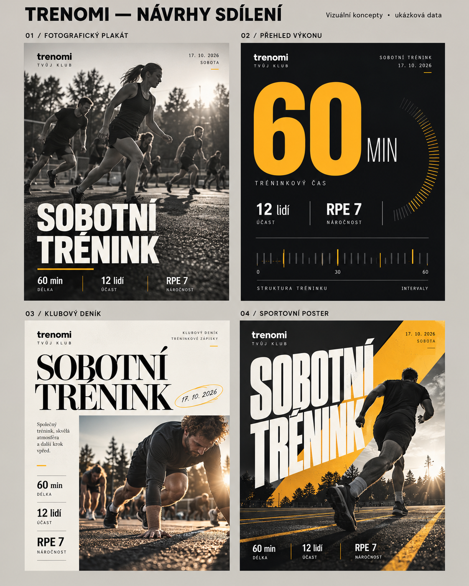

# Návrhy vzhledu grafiky pro sdílení tréninku

Vizuální návrhy pro výběr směru, nikoli již zapojené exportní šablony. Fotografie, čísla i popisky na návrzích jsou ilustrační. Přesun tlačítka smazání je samostatná hotová změna.

| Směr | Vzhled a použití | Zapojení do aplikace |
| --- | --- | --- |
| 01 Fotografický plakát | Fotografie přes celou plochu, výrazný čitelný titulek a jemný pás s údaji. Běžné ohlédnutí za tréninkem. | Jedna vybraná fotografie, nastavení výřezu, název/datum a nejvýše tři metriky. |
| 02 Přehled výkonu | Velká dominantní hodnota, přesná typografická mřížka a doplňující údaje. Funguje i bez fotografie. | Volba hlavní skutečné metriky (čas, vzdálenost nebo výkon), graf pouze z dostupných uložených měření. |
| 03 Klubový deník | Světlá magazínová kompozice, fotografie, krátký text a datový sloupec. Komunitní příspěvek, atmosféra tréninku. | Jedna fotografie a stručný vlastní komentář; případný výběr více fotografií lze doplnit později. |
| 04 Sportovní poster | Výrazný velký titulek, diagonály, fotografie a silný žlutý akcent. Energické Stories a sportovní výsledky. | Fotografie oříznutá do grafické kompozice, žádné nutné automatické odstraňování pozadí. |

Doporučení: jako základ zpracovat 01 a 02. První využije kvalitní fotografii, druhá zůstává plnohodnotná i bez ní. 03 nabídne světlou alternativu; 04 je nejvýraznější sportovní varianta.

## Společné chování

- V existujícím panelu Sdílet trénink vybírat styl pomocí miniatur, formát a skutečné údaje; zachovat živý náhled, PNG a systémové sdílení telefonu.
- Zachovat 1080×1080, 1080×1350 a 1080×1920. Každý poměr má vlastní kompozici, ne roztažený stejný obrázek. U Stories respektovat horní a dolní oblast překrytou ovládáním sociální sítě.
- Název a logo vybraného klubu, skutečné soubory značky Trenomi z public/brand, výchozí žlutá #FFB317 a tmavá #101216. Exportní styl není vázaný na světlý/tmavý režim aplikace.
- Automaticky nabízet uložený název, datum, místo, délku, účast, vzdálenost a RPE. Prázdné údaje skrývat. Jména zůstanou ve výchozím stavu skrytá jako dnes.
- Návrhy obsahují generované demonstrační fotografie a dekorativní grafické prvky. Výsledný export používá vlastní fotografie klubu a číselné grafy jen ze skutečných dat deníku; nepotřebuje generování AI při každém sdílení.

## Technický postup po výběru

Rozšířit stávající renderování v src/journalShare.ts o samostatné kompozice, aktualizovat volbu stylu v src/JournalSharePanel.tsx a doplnit datum/místo/klubové logo z detailu tréninku. Použít lokálně přibalené licenčně vhodné fonty, aby vzhled PNG nezávisel na zařízení. Ověřit dlouhé české názvy, chybějící foto/údaje, načtení loga, tři exportní poměry a mobilní sdílení. Pro tyto vzhledy není nutná změna databázových záznamů ani přímé propojení účtu Instagram/Facebook.
